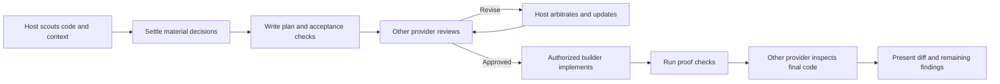

<div align="center">


### Skills for working across Claude Code and Cursor agent.

[](./LICENSE)
</div>

A fork of [chaseai-yt/claudex-loop](https://github.com/chaseai-yt/claudex-loop) that swaps Codex for the [Cursor agent CLI](https://cursor.com/docs/cli/overview) (`agent` / `cursor-agent`). One provider plans; the other independently reviews the plan and inspects the final code.

| Skill | Use it for | Dependencies |
|---|---|---|
| [`claudor-route`](skills/claudor-route/SKILL.md) | A model recommendation or one scoped handoff | Self-contained; selected CLI needed only for delegation |
| [`claudor-loop`](skills/claudor-loop/SKILL.md) | Requirements, plan review, implementation, and final inspection | Both CLIs and Python 3.10+ |
| [`cursor-review`](skills/cursor-review/SKILL.md) | Explicit Cursor plan-review command | Shared `claudor-loop` skill |
| [`cursor-build`](skills/cursor-build/SKILL.md) | Explicit Cursor builder command | Shared `claudor-loop` skill |

## Claudor Loop

| Start here | Requirements and plan | Plan review | Default build | Final inspection |
|---|---|---|---|---|
| **Claude Code** | Current Claude session | Cursor agent | Claude | Fresh Cursor agent session |
| **Cursor** | Current Cursor session | Claude | Cursor | Fresh Claude session |

Choose either builder with `builder=claude` or `builder=cursor`. The inspector is always the other provider. If the coordinator takes over fixes, those edits need another independent inspection.



`PLAN.md` records what to build; `PLAN-REVIEW-LOG.md` records findings, dispositions, models, proof and remaining uncertainty. Both paths are configurable. CLI diagnostics live in a unique directory outside the target checkout.

## Cursor models

Cursor can run many models, including Anthropic ones, so claudor-loop guards the "independent" part:

- **Default:** `grok-4.7-high`. Grok 4.5–4.7 and Composer 2.5 are in Cursor's included usage pool; most other models draw paid usage.
- **Your own default:** `export CLAUDOR_CURSOR_MODEL=composer-2.5` (or any id from `agent models`). Per run: `reviewer_model=`, `builder_model=`, `inspector_model=`.
- **Effort** is part of the Cursor model id (`grok-4.7-medium`, `grok-4.7-xhigh`); `*_effort` applies only to Claude.
- **Anthropic models are refused** on the Cursor side, before launch and again if Cursor reports one: Claude reviewing Claude is not a second opinion.
- **`auto`** hides which model actually ran. It requires `--allow-unverified-model`, and results are recorded as `independence: unverified`.

Every result records the requested model, where it came from (`argument`, `env`, `default`) and the model Cursor reported running.

## Install

### 1. Prerequisites

| Requirement | Install | Check |
|---|---|---|
| Python 3.10+ | system package manager | `python3 --version` |
| Claude Code | [docs](https://code.claude.com/docs/en/setup) | `claude --version`, `claude auth status` |
| Cursor agent CLI | `curl https://cursor.com/install -fsS \| bash`, then `agent login` | `agent --version`, `agent status` |

The runner launches the CLI (`cursor-agent` or `agent` on PATH), not the Cursor IDE. No pip packages or API keys are needed at runtime.

### 2a. Claude Code (plugin)

From GitHub:

```text
/plugin marketplace add okkindel/claudor-loop
/plugin install claudor-loop@claudor-loop
```

Or from a local checkout (for development):

```text
/plugin marketplace add /path/to/claudor-loop
/plugin install claudor-loop@claudor-loop
```

Restart Claude Code, then use `/claudor-loop:claudor-loop`, `/claudor-loop:claudor-route`, `/claudor-loop:cursor-review` or `/claudor-loop:cursor-build`. Update with `/plugin marketplace update claudor-loop`.

### 2b. Cursor

Load the checkout as a plugin for one session:

```bash
agent --plugin-dir /path/to/claudor-loop
```

Or copy the skills so both hosts always see them:

```bash
# run from this repository
mkdir -p ~/.cursor/skills ~/.claude/skills
cp -R skills/. ~/.cursor/skills/
cp -R skills/. ~/.claude/skills/
```

Copy all skill directories together: the compatibility commands share the runtime inside `claudor-loop`. `claudor-route` can be installed on its own. Updates are `git pull` and re-copy.

### 3. Optional configuration

```bash
# Default Cursor model (otherwise grok-4.7-high); list ids with `agent models`
export CLAUDOR_CURSOR_MODEL=composer-2.5
```

When Cursor is the builder, it runs without `--force`, so shell commands such as tests run only if allowed in `~/.cursor/cli-config.json`, e.g. `"permissions": {"allow": ["Shell(npm)", "Shell(python3)"]}`. Otherwise the builder reports them as refused and the host runs the proof itself.

Cursor reviews refuse to start while Cursor MCP servers are configured (`agent mcp list`), because plan mode does not restrict MCP tools. Remove them or pass `--allow-cursor-mcp` knowingly.

### 4. Smoke test

```bash
python3 skills/claudor-loop/scripts/runner.py roles --host claude
```

prints the role table (Claude plans and builds, Cursor reviews and inspects) without calling a model.

### Examples

```text
claudor this feature — plan and implement it
claudor this plan, mode=review, plan=docs/migration.md, rounds=3
claudor this feature, builder=cursor, builder_model=composer-2.5
claudor this feature, reviewer_model=grok-4.7-xhigh
```

## Controls

| Argument | Default | Purpose |
|---|---|---|
| `mode` | `full` | `review` starts from an existing plan |
| `plan` / `PLAN_FILE` | `PLAN.md` | Plan path, carried through every phase |
| `log` / `LOG_FILE` | `PLAN-REVIEW-LOG.md` | Append-only decision log |
| `builder` | current host | `claude` or `cursor` |
| `reviewer_model`, `builder_model`, `inspector_model` | Cursor: `$CLAUDOR_CURSOR_MODEL` or `grok-4.7-high`; Claude: CLI configuration | Per-role model override |
| `reviewer_effort`, `builder_effort`, `inspector_effort` | Claude CLI configuration | Claude only; Cursor effort is in the model id |
| `rounds` / `MAX_ROUNDS` | `5` | Completed plan-review round cap |
| `MAX_FIX_ROUNDS` | `2` | Build-fix attempt cap |
| `MAX_INSPECTION_ROUNDS` | `2` | Initial inspection plus one reinspection |
| `research` | proportionate to task | `none`, `web`, or explicitly authorized `deep` |
| `inspect` | `on` | `off` is an explicit, logged opt-out |
| `PROOF_CMD` | from plan/repo | Agreed command that verifies the deliverable |

## What an approval means

The runner validates a successful CLI turn and a structured review; an empty output or a session-start event cannot count as approval. The approval records the plan's path and SHA256; changing the plan invalidates it. Inspections record the pre-build commit and a fingerprint of the inspected changes, including staged and untracked files. Later code changes need another inspection.

A clean structured result does not prove the model is right. Zero findings is valid; a large number of findings is not a quality score. `BLOCKED`, execution failures and exhausted round budgets are surfaced rather than converted to approval.

Cursor reviews run in plan mode with a private Cursor config that denies all shell commands and writes (plan mode alone lets some commands through), and refuse to start while Cursor MCP servers are configured unless `--allow-cursor-mcp` is passed. Claude reviews expose only file reading/search, with customizations disabled and no MCP tools. Cursor builders never get `--force`: shell commands outside your Cursor allowlist are refused and reported. Delegated builds require a clean checkout. Details: [runtime reference](skills/claudor-loop/references/runtime.md).

## Development and verification

```text
python -m pip install -r requirements-dev.txt
python scripts/validate.py
python -m unittest discover -s tests -v
```

Tests use disposable Git repositories and fake CLI processes, without model quota. Live CLI checks are recorded in [VALIDATION.md](VALIDATION.md).

## Credits

- Claudex Loop, cross-model review design, runner and packaging: [Chase AI](https://youtube.com/@chaseai) ([chaseai-yt/claudex-loop](https://github.com/chaseai-yt/claudex-loop)), MIT. See [ACKNOWLEDGMENTS.md](ACKNOWLEDGMENTS.md) for the upstream community contributions.
- Legacy interview skills in [legacy/](legacy/): © [Matt Pocock](https://github.com/mattpocock/skills), MIT.
- Cursor adapter: [okkindel](https://github.com/okkindel).

[MIT license](LICENSE)
